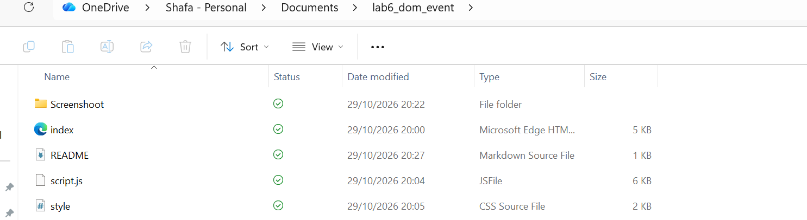
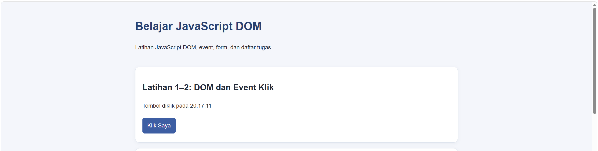
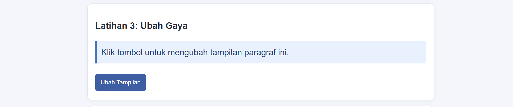
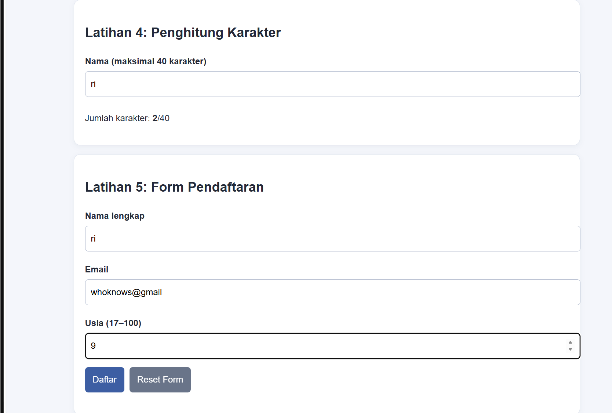
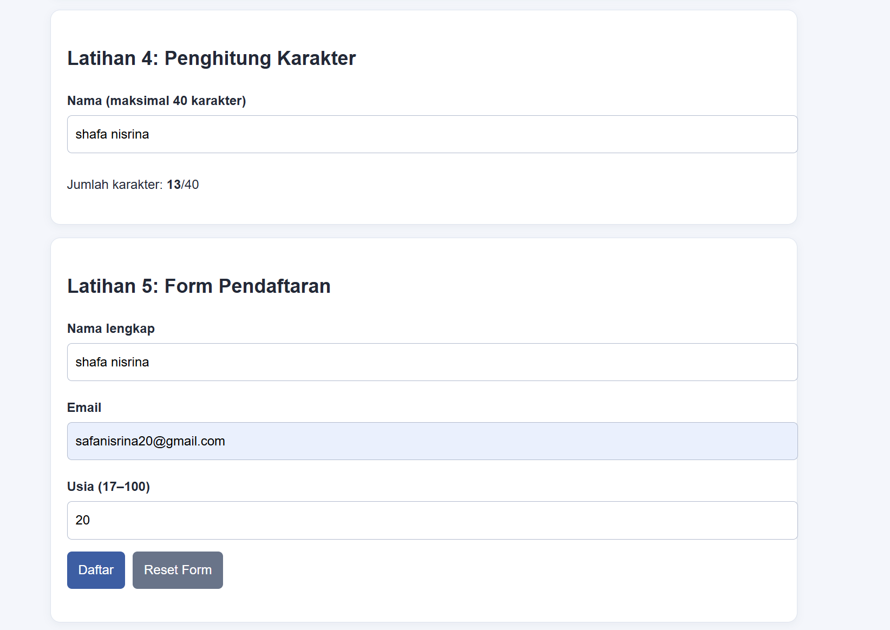
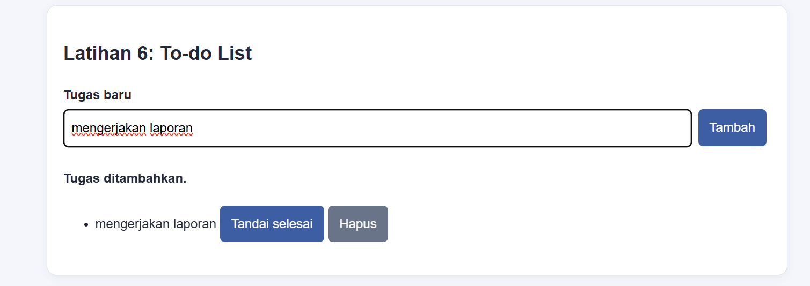
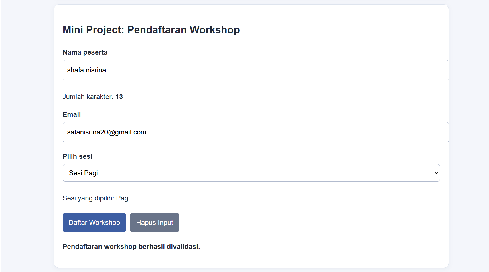
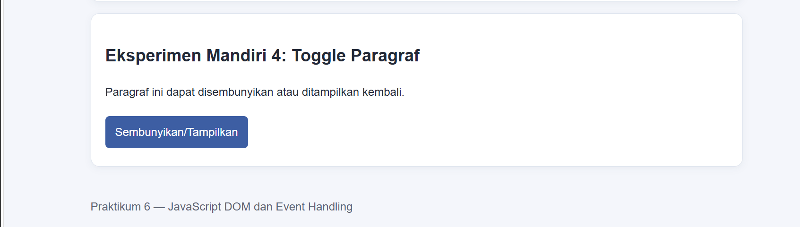
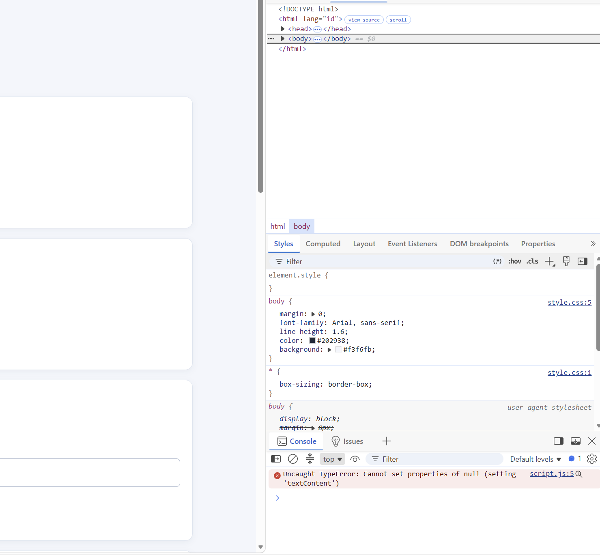

# Praktikum 6 — JavaScript DOM dan Event Handling

## Identitas

- Nama: Shafa Nisrina
- NIM: 312510360
- Mata kuliah: Pemrograman Web
- Pertemuan: 7

## Tujuan

Praktikum ini mempelajari cara memilih dan mengubah elemen HTML dengan JavaScript, menangani event, menghitung karakter, memvalidasi form, dan membuat daftar tugas sederhana.

## Struktur Folder

```text
Lab6Web/
├── index.html
├── style.css
├── script.js
├── README.md
└── screenshot/ 
Simpan screenshot hasil praktikum di folder screenshot.




Cara Menjalankan
1. Buka folder Lab6Web di Visual Studio Code.
2. Pastikan index.html, style.css, dan script.js berada di folder yang sama.
3. Buka index.html di browser.
4. Tekan F12 dan buka tab Console jika ingin memeriksa pesan error.
Hasil Praktikum
1. Latihan 1–2 — DOM dan event klik
   Judul dan pesan diubah menggunakan DOM. Tombol menampilkan waktu saat diklik.
2. Latihan 3 — Mengubah gaya
   Tombol menambah atau menghapus class CSS pada paragraf.
3. Latihan 4 — Penghitung karakter
   Jumlah karakter diperbarui saat pengguna mengetik, dengan batas 40 karakter.
4. Latihan 5 — Validasi form
   Form memeriksa nama, format email, dan usia antara 17–100.
5. Latihan 6 — To-do List
   Pengguna dapat menambahkan tugas, menandai tugas selesai, dan menghapus tugas.
6. Mini Project — Pendaftaran workshop
   Form memeriksa nama minimal tiga karakter, format email, dan pilihan sesi. Jumlah karakter nama juga ditampilkan.
7. Eksperimen Mandiri 4 — Toggle paragraf
   Tombol menyembunyikan atau menampilkan paragraf menggunakan class CSS.
Pengujian

## Pertanyaan Evaluasi

1. Apa yang dimaksud dengan DOM dan apa manfaatnya? 
   DOM (Document Object Model) adalah representasi dokumen HTML sebagai objek yang bisa diakses JavaScript. DOM bermanfaat untuk memilih dan mengubah elemen, isi, atribut, serta tampilan halaman, juga merespons tindakan pengguna.

2. Apa perbedaan `getElementById()`, `querySelector()`, dan `querySelectorAll()`? 
   `getElementById()` memilih elemen berdasarkan ID. `querySelector()` memilih elemen pertama yang cocok dengan selector CSS. `querySelectorAll()` memilih semua elemen yang cocok dengan selector CSS.

3. Apa fungsi `addEventListener()` dan sebutkan tiga contoh event? 
   `addEventListener()` menghubungkan event dengan fungsi yang dijalankan saat event terjadi. Contoh event: `click`, `input`, dan `submit`.

4. Mengapa `event.preventDefault()` digunakan pada event submit form?
   Untuk mencegah perilaku bawaan form, seperti memuat ulang halaman, agar JavaScript bisa memeriksa input dan menampilkan hasil validasi.

5. Apa perbedaan `textContent` dan `innerHTML` dari sisi penggunaan dan keamanan?  
   `textContent` membaca atau mengisi teks biasa. `innerHTML` membaca atau mengisi markup HTML. Untuk menampilkan teks dari pengguna, `textContent` lebih aman karena teksnya tidak diproses sebagai markup.

6. Bagaimana `classList.toggle()` membantu mengubah tampilan elemen?
   `classList.toggle()` menambahkan class jika belum ada dan menghapusnya jika sudah ada. Dengan begitu, tampilan elemen dapat diaktifkan atau dikembalikan lewat tombol.

7. Sebutkan minimal tiga skenario pengujian validasi form.
   Nama kosong, format email tidak valid, dan usia di bawah 17. Pengujian tambahan: usia di atas 100 dan semua data valid.
   
Form pendaftaran diuji dengan kondisi berikut:
- Nama kosong.
- Format email tidak valid.
- Usia di bawah 17.
- Data valid.
Form workshop juga diuji dengan nama kurang dari tiga karakter, email tidak valid, sesi belum dipilih, dan data valid.
Eksperimen Mandiri Modul
Catat hasil eksperimen lainnya di sini setelah dikerjakan:
1. Menghapus tugas: "Tugas dihapus".
2. Validasi nama minimal tiga karakter: ” Nama tiga karakter atau lebih dapat melanjutkan validasi".
3. Event change pada pilihan sesi: Saat pilihan sesi diganti, teks pada halaman langsung menampilkan sesi yang dipilih.
4. Toggle paragraf: Sudah diterapkan pada halaman.
5. Mencoba script tanpa defer: Script dijalankan sebelum elemen HTML selesai dibaca. Akibatnya, elemen yang dicari bisa bernilai null, sehingga JavaScript gagal memasang event listener dan menampilkan error di Console.

Screenshot
Simpan bukti praktikum di folder screenshot. Contoh nama file:
- latihan-1-2.png

- latihan-3.png

- latihan-4.png

- form-gagal.png

- form-berhasil.png

- todo-list.png

- mini-project.png

- eksperimen.png

-eksperimen mandiri tanpa defer

Kesimpulan
Praktikum ini menunjukkan bahwa JavaScript dapat digunakan untuk mengakses dan mengubah elemen HTML, merespons event pengguna, memvalidasi input form, serta membuat halaman web yang interaktif.